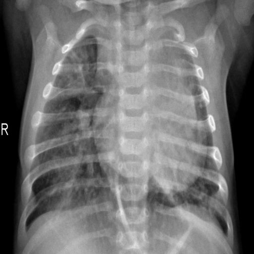
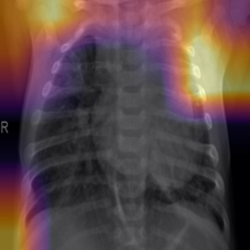
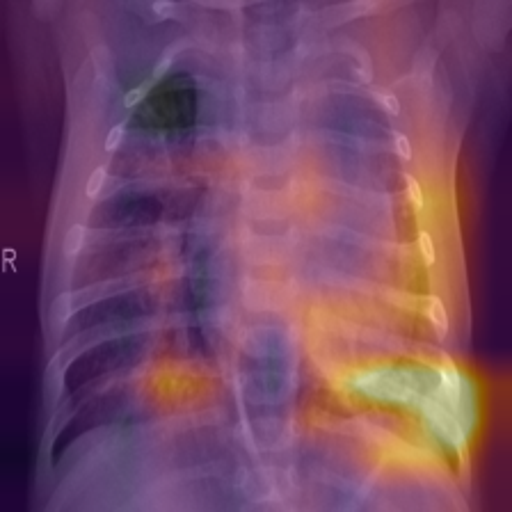
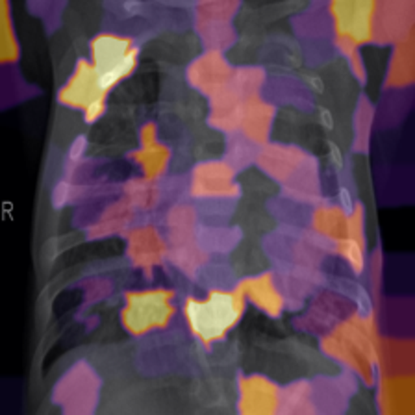
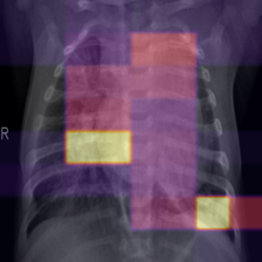
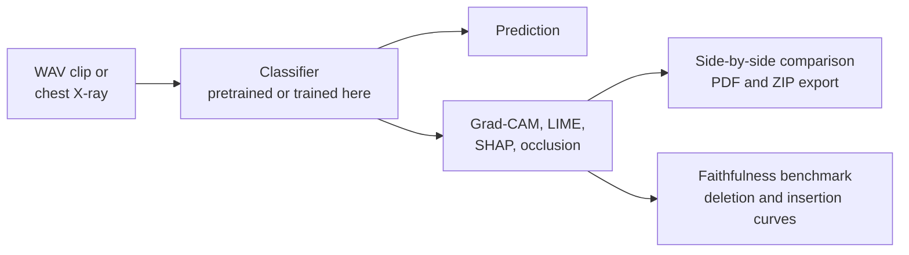
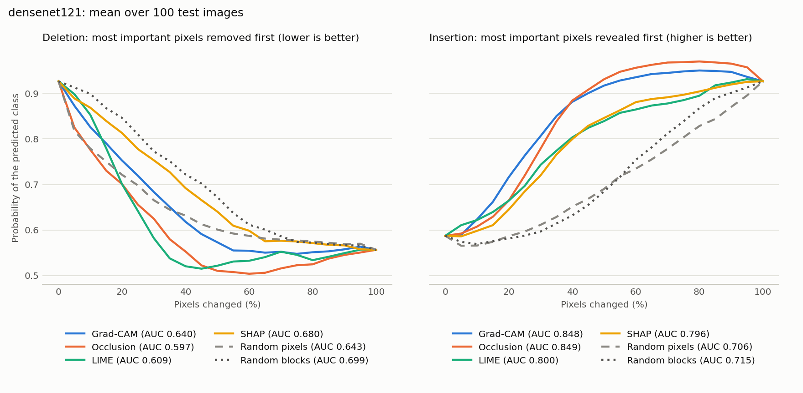

# Unified XAI Interface for Audio and Chest X-ray Classification

A single Streamlit application that classifies audio clips (bona fide vs spoofed speech) and chest X-rays (normal vs pneumonia), then explains each prediction with Grad-CAM, LIME, SHAP and occlusion sensitivity.
Beyond the interface, the project measures how far these explanations can be trusted: the four methods are compared on 100 test radiographs with deletion and insertion curves and two random references.

Explainable AI course project, ESILV, January 2026. Author: Sami Chellia.

| Input | Grad-CAM | Occlusion | LIME | SHAP |
|---|---|---|---|---|
|  |  |  |  |  |

One test radiograph of the pneumonia class, predicted pneumonia with probability 0.974. The four methods agree on the lung fields but not on the exact regions; the benchmark below quantifies which rankings the classifier actually depends on.



## Key results

### Classification

Chest X-ray classifiers trained on [`hf-vision/chest-xray-pneumonia`](https://huggingface.co/datasets/hf-vision/chest-xray-pneumonia): 4,434 training and 782 validation images taken from the training split (85 / 15, fixed seed), then the official test split of 624 images (234 normal, 390 pneumonia). AdamW, learning rate 1e-4, 224 x 224 inputs, seed 0, weights of the best validation epoch.

| Model | Training | Validation accuracy | Test accuracy | Balanced accuracy | Recall | Specificity | F1 | AUC |
|---|---|---|---|---|---|---|---|---|
| DenseNet121 | ImageNet weights, augmentation, class-balanced loss, 6 epochs | 0.981 | **0.934** | **0.917** | 0.987 | **0.846** | **0.949** | **0.987** |
| DenseNet121 | random initialisation, 3 epochs | 0.977 | 0.800 | 0.735 | 0.995 | 0.474 | 0.861 | 0.930 |
| AlexNet | random initialisation, 3 epochs | 0.971 | 0.742 | 0.657 | 0.997 | 0.316 | 0.829 | 0.940 |
| Always pneumonia | - | - | 0.625 | 0.500 | 1.000 | 0.000 | 0.769 | - |

The three models look alike in validation (0.97 to 0.98) and very different on the test split. Trained from scratch, DenseNet121 calls 123 of 234 normal test radiographs pneumonia; with ImageNet weights, augmentation and a class-balanced loss it calls 36.

Audio: a ResNet18 on log-mel spectrograms reaches a validation accuracy of 0.997 on 600 clips, after training on 3,400 clips of ASVspoof 2019 LA (balanced classes). Validation and training clips come from the same subset, so this figure says nothing about unseen speakers or attacks.

### How faithful are the explanations?

Best DenseNet121, 100 test images (50 per class, seed 0; 91 are classified correctly). Pixels are removed, or revealed on a blurred copy, in the order given by each heatmap, and the probability of the predicted class is recorded.

| Method | Deletion AUC (lower is better) | Insertion AUC (higher is better) | Share of the top 10 % area in the image border |
|---|---|---|---|
| Occlusion | **0.597** | **0.849** | 0.057 |
| Grad-CAM | 0.640 | 0.848 | 0.051 |
| LIME (1,400 samples) | 0.609 | 0.800 | 0.281 |
| SHAP (400 evaluations) | 0.680 | 0.796 | 0.094 |
| Random pixels | 0.643 | 0.706 | 0.361 |
| Random 16-pixel blocks | 0.699 | 0.715 | 0.360 |



1. **The four methods beat a random ranking of regions on both curves.** On insertion, occlusion is better than random blocks on 100 images out of 100, LIME on 99, Grad-CAM on 96 and SHAP on 73.
2. **Occlusion is the most faithful method, Grad-CAM a close second at a fraction of the cost** (one backward pass against 196 forward passes).
3. **Random pixels are a hard reference for deletion.** Scattered pixel noise damages the image as much as removing the regions Grad-CAM points to (0.643 against 0.640), and SHAP does worse than this reference. Deletion scores should always be read next to it.
4. **Explanations follow the quality of the model.** The same benchmark on the classifier trained from scratch gives no gain above 0.02 on insertion over random pixels (against +0.14 here), and LIME returned an empty map on 22 of 100 images (against none here).
5. **Grad-CAM, occlusion and SHAP look at the centre of the image**: less than 10 % of their most important area lies in the outer band, against 36 % for a random map.

Source files: [`results/`](results).

### Limitations

- One training seed. The decision threshold is 0.5, not calibrated on held-out data.
- Deletion and insertion depend on the replacement used (mean colour and Gaussian blur here), and the perturbed images are outside the training distribution.
- SHAP and LIME were run with the default budgets of the interface. Larger budgets were not tried.
- No faithfulness study for the audio models.
- This is a teaching project. It is not a medical device and must not be used for diagnosis.

## Methodology

### Models

| Modality | Model | Weights |
|---|---|---|
| Audio | Wav2Vec2 audio classifiers (two checkpoints) | Hugging Face hub |
| Audio | VGG16, ResNet18, MobileNetV3-Small on log-mel spectrograms | trained with `src/train/train_audio_spectro.py` |
| Chest X-ray | DenseNet121 (CheXpert and NIH) from TorchXRayVision | pretrained |
| Chest X-ray | AlexNet, DenseNet121 | trained with `src/train/train_xray.py` |

The TorchXRayVision models are multi-label. The interface reduces them to one binary score, the maximum probability over a fixed list of lung findings.

### Explanation methods

| Method | Chest X-ray | Audio |
|---|---|---|
| Grad-CAM | Last 2D convolution (last dense block for DenseNet) | Last 1D convolution (Wav2Vec2) or last 2D convolution (spectrogram CNN) |
| LIME | 160 SLIC superpixels | Time segments kept or silenced (tabular LIME on masks) |
| SHAP | Partition explainer with a blur masker | Kernel SHAP on segment masks |
| Occlusion | 32-pixel patches, stride 16, replaced by the mean colour | One segment silenced at a time |

For audio, the waveform is cut into equal time segments (32 by default). A binary mask selects the segments that are kept; the others are set to zero before the model is called.

### Faithfulness benchmark

For each image, each method ranks the 224 x 224 pixels. The deletion curve replaces the top-ranked pixels by the mean colour of the image, in 20 steps; the insertion curve starts from a blurred image and restores the top-ranked pixels. The score is the area under the probability of the initially predicted class (Petsiuk et al., 2018). Two random rankings give the reference: independent pixels, and 16-pixel blocks, the fair comparison for methods that rank regions.

## Project structure

```
├── app.py               Streamlit interface
├── src/
│   ├── models/          model wrappers and registry
│   ├── xai/             Grad-CAM, LIME, SHAP, occlusion (image and audio)
│   ├── eval/            test-set evaluation, faithfulness benchmark
│   ├── train/           training scripts
│   ├── utils/           audio and image processing, charts, export
│   └── report/          PDF report
├── scripts/             data preparation, demo files, galleries, figures
├── tests/               CPU-only unit tests
├── results/             metrics of the reported runs
├── assets/              README figures
└── Dockerfile, docker-compose.yml
```

Interface labels are in French.

## Quickstart

Python 3.10 or later.

```bash
git clone https://github.com/samichellia90-bit/unified-xai-audio-xray.git
cd unified-xai-audio-xray
python -m venv .venv
source .venv/bin/activate          # Windows: .venv\Scripts\activate
pip install -r requirements.txt

python scripts/download_demo_pro_data.py   # a few labelled clips and X-rays in data/demo
streamlit run app.py
```

With Docker: `docker compose up --build`, then open http://localhost:8501.

Unit tests (no download, CPU only): `pip install pytest && pytest` (11 tests).

## Reproducing the results

A GPU is recommended for training and for the benchmark.

```bash
# Data: training and test splits of the X-ray dataset, a balanced audio subset
python scripts/prepare_real_datasets.py --only images --max-per-label 0 --image-split train --image-out data/xray
python scripts/prepare_real_datasets.py --only images --max-per-label 0 --image-split test --image-out data/xray_test
python scripts/prepare_real_datasets.py --only audio --max-per-label 2000

# Training (drop the three options to train from scratch)
python -m src.train.train_xray --data_dir data/xray --arch densenet121 --epochs 6 --batch 16 \
    --pretrained --augment --balanced_loss
python -m src.train.train_audio_spectro --data_dir data/audio --arch resnet18 --epochs 5

# Test-set evaluation and faithfulness benchmark
python -m src.eval.evaluate_xray --arch densenet121 --weights weights/image/densenet121_xray.pth \
    --data_dir data/xray_test --out results/test/densenet121_pretrained.json
python -m src.eval.faithfulness --arch densenet121 --weights weights/image/densenet121_xray.pth \
    --data_dir data/xray_test --per_class 50 --out results/faithfulness/densenet121_pretrained
python scripts/plot_faithfulness.py --summary results/faithfulness/densenet121_pretrained/summary.json \
    --out assets/faithfulness_densenet121.png
```

Weights are written to `weights/image/` and `weights/audio/`. The interface lists a custom model as unavailable until its weights exist.

## Data

No dataset is redistributed in this repository, apart from the example figures above.

- Chest X-rays: D. Kermany et al., "Identifying Medical Diagnoses and Treatable Diseases by Image-Based Deep Learning", Cell, 2018 (CC BY 4.0).
- Audio: ASVspoof 2019 LA for training and ASVspoof 2017 for the demo clips, loaded from the Hugging Face hub.
- Optional demo files are downloaded from Wikimedia Commons by `scripts/download_demo_data.py`.

## References

- R. Selvaraju et al., "Grad-CAM: Visual Explanations from Deep Networks via Gradient-Based Localization", ICCV 2017.
- M. Ribeiro, S. Singh and C. Guestrin, "Why Should I Trust You? Explaining the Predictions of Any Classifier", KDD 2016.
- S. Lundberg and S.-I. Lee, "A Unified Approach to Interpreting Model Predictions", NeurIPS 2017.
- M. Zeiler and R. Fergus, "Visualizing and Understanding Convolutional Networks", ECCV 2014.
- V. Petsiuk, A. Das and K. Saenko, "RISE: Randomized Input Sampling for Explanation of Black-box Models", BMVC 2018.
- J. P. Cohen et al., "TorchXRayVision: A Library of Chest X-ray Datasets and Models", MIDL 2022.
- A. Baevski et al., "wav2vec 2.0: A Framework for Self-Supervised Learning of Speech Representations", NeurIPS 2020.

## License

MIT. See [LICENSE](LICENSE).
